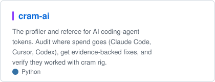
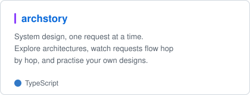

<picture>
  <source media="(prefers-color-scheme: dark)" srcset="banner-dark.svg">
  
</picture>

<p align="center">
  <a href="https://pypi.org/project/cram-ai"></a>
  
</p>

I hit a hard monthly token budget doing ordinary work with an AI coding agent.
Following month, I started measuring where every token
went. That turned into an obsession with **AI engineering** — and everything below.

## Projects

<p>
  <a href="https://github.com/vishbay/cram-ai">
    <picture>
      <source media="(prefers-color-scheme: dark)" srcset="card-cram-ai-dark.svg">
      
    </picture>
  </a>
  <a href="https://github.com/vishbay/archstory">
    <picture>
      <source media="(prefers-color-scheme: dark)" srcset="card-archstory-dark.svg">
      
    </picture>
  </a>
</p>

```bash
pip install 'cram-ai[mcp]' && cram audit
```

[Try archstory live](https://vishbay.github.io/archstory/) · [cram-ai on PyPI](https://pypi.org/project/cram-ai)

---

*Opinions here are measurements in disguise.*
